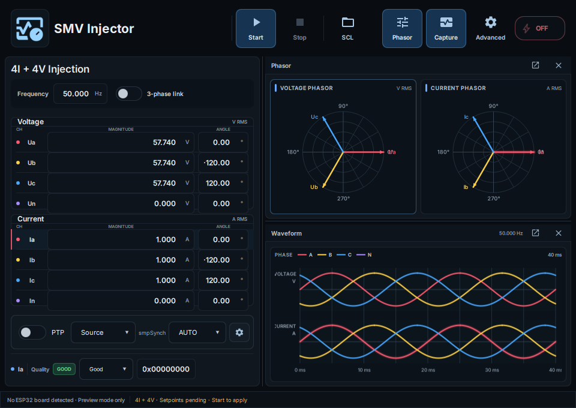

# ARStack61850

**Your practical IEC 61850 Process Bus traffic generator — free, open-source, real Ethernet output**

Use **ARStack Studio** and one affordable **ESP32-P4 Ethernet board** to generate actual IEC 61850 Sampled Values and PTP traffic for process-bus and digital-substation lab simulation. Give a relay, BCU or analyzer a configurable SV stream to subscribe to, inspect its behavior and troubleshoot engineering configurations without needing a full physical Merging Unit test rack.

[**Download the latest stable release**](https://github.com/masarray/arstack61850/releases/latest) · [**Getting started**](docs/GETTING_STARTED.md) · [**Product website**](https://masarray.github.io/arstack61850/) · [**Get help**](SUPPORT.md)

## What you can do

| Explore | With ARStack |
| --- | --- |
| **Inject real Process Bus traffic** | Publish 4 current + 4 voltage channels over Ethernet at nominal 4,000 SV frames/s; use this traffic as lab input for relay/BCU/analyzer experiments. |
| **Simulate SV + PTP together** | Generate IEC 61850 SV frames alongside PTP Announce/Sync/Follow_Up with an internal laboratory PTP SOURCE; inspect `smpSynch` and signal timing. |
| **Control waveforms** | Set 4I+4V current, voltage and phase values; the powered board keeps publishing if Studio closes and Studio re-adopts its state when reopened. |
| **Inspect and troubleshoot** | Use Studio or Wireshark to inspect SV/PTP; compare APPID, svID, multicast MAC and VLAN with the subscriber configuration. Other analyzers can be tried with matching filters. |
| **Try engineering-file profiles** | Import supported SCL/SCD/CID/IID SV engineering configurations; inspect stream identity and deploy supported single-stream 4I+4V profiles. |

**M3.H.3 official stable lab release:** **4,705,090 SV frames** captured across **19 min 36 s** at **3,999.886 fps**, with **zero missing, duplicate, reordered or malformed SV frames**. SV and PTP were on the wire, and all received SV carried `smpSynch=2` in the internal lab timing profile. Close Studio and the powered ESP32-P4 keeps publishing; reopen it and Studio adopts the live board state. [Capture details](docs/releases/PROCESSBUS_AUTONOMOUS_M3H3_OFFICIAL_20261025.md).

## Next: multiple virtual Merging Units from one ESP32-P4

**Roadmap: Multi-SV + SCL-driven MU simulation.** The next engineering phase is to publish **multiple independently identifiable SV streams** concurrently from a single ESP32-P4, then let engineers **open an SCL/SCD/CID file, choose SV streams and deploy their supported DataSet/communication profiles**. One small board, multiple process-bus sources, real Ethernet packets. These are **upcoming features**, not included in the M3.H.3 single-stream release. [Implementation roadmap](docs/PROCESS_BUS_MULTI_SV_SCL_NEXT_PHASE.md).

## Inside ARStack Studio

*Screenshot captured directly from the Windows Qt application by the native GUI test.*

## Get started in minutes

1. **[Download ARStack Studio](https://github.com/masarray/arstack61850/releases/latest)** for Windows x64 (Setup EXE or Portable ZIP).
2. Open Studio and try the built-in **4I+4V Quick Start** profile. You can explore the interface before connecting hardware.
3. To transmit real Ethernet frames, connect a compatible **ESP32-P4 Ethernet** board over USB and Ethernet. Use **Configuration → Firmware** to install the firmware bundled with **the same release**.
4. Choose **PTP SOURCE / INTERNAL_GM_ONLY**, set **SMPSYNCH AUTO**, configure voltage/current waveforms, and press **Start**. Studio can be closed while the board stays powered and Ethernet remains connected.
5. View the output using Studio capture or Wireshark (`0x88BA` for SV, `0x88F7` for PTP).

**[Full first-run guide →](docs/GETTING_STARTED.md)** · [Installation on Windows and Linux](docs/INSTALL.md)

For active SV/PTP transmission, use an **isolated laboratory Ethernet network**, not an operating substation process bus.

## Downloads and platforms

| Package | Availability |
| --- | --- |
| Windows Setup EXE | **Available** in [M3.H.3 official stable](https://github.com/masarray/arstack61850/releases/latest) |
| Windows Portable ZIP | **Available** in [M3.H.3 official stable](https://github.com/masarray/arstack61850/releases/latest) |
| Matched ESP32-P4 firmware | **Available** with the same release |
| Linux AppImage | **Available** in [M3.H.3 official stable](https://github.com/masarray/arstack61850/releases/latest) |

Every published Windows release includes the application dependencies and a matched firmware package; no C++ build environment is required for ordinary installation.

## Community

ARStack is built to make IEC 61850 experiments more accessible to engineers, students and automation enthusiasts around the world.

- **[Ask a question or report a problem](SUPPORT.md)** — share what you tried and what happened.
- **[Share your lab result](docs/COMMUNITY_TESTING.md)** — relay/BCU screenshots, stream configuration and Wireshark results are welcome; hardware purchase or formal test reports are **not** required.
- **[SCL import help](docs/SCL_TROUBLESHOOTING.md)** — a practical path when imported SV fields do not appear.
- **[Contribute](CONTRIBUTING.md)** — improvements to documentation, software, tests and examples are welcome.

ARStack uses the [GPL-3.0 license](LICENSE). **Run it on an isolated bench/test network, not an energized/live substation process bus.** It generates simulated traffic, not calibrated primary measurement data.

## For developers

Want to explore the protocol engine or build from source? Start with the [developer documentation index](docs/DEVELOPER_GUIDE.md).

The source tree includes a portable C++20 IEC 61850 protocol engine, SCL/COMTRADE tooling, MMS and GOOSE foundations, ESP32-P4 firmware and reproducible tests. Capabilities vary by application and release; the [feature matrix](docs/FEATURE_MATRIX.md) separates released tools from libraries and development features.
