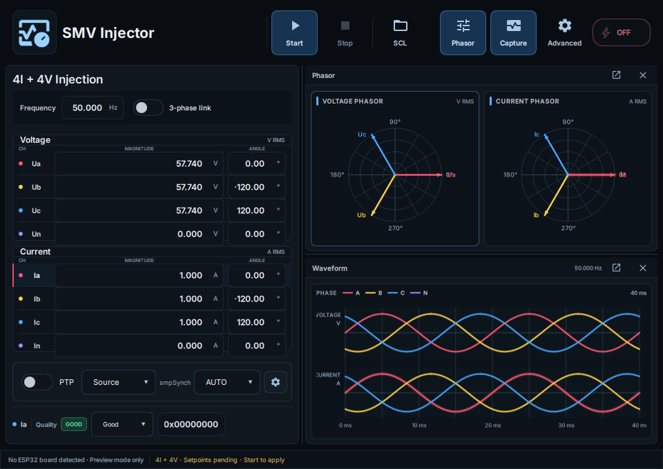

# ARStack61850

**Your practical IEC 61850 Process Bus traffic generator — free, open-source, real Ethernet output**

Use **ARStack Studio** and one affordable **ESP32-P4 Ethernet board** to generate actual IEC 61850 Sampled Values and PTP traffic for process-bus and digital-substation lab simulation. Give a relay, BCU or analyzer a configurable SV stream to subscribe to, inspect its behavior and troubleshoot engineering configurations without needing a full physical Merging Unit test rack.

[**🪟 Download for Windows — Setup ZIP**](https://github.com/masarray/arstack61850/releases/download/processbus-sim-dual-stable-20261105/ARStack-Studio-win-x64-setup.zip) · [**🐧 Download for Linux — AppImage**](https://github.com/masarray/arstack61850/releases/download/processbus-sim-dual-stable-20261105/ARStack-Studio-linux-x86_64.AppImage) · [**Latest stable release**](https://github.com/masarray/arstack61850/releases/latest) · [**Getting started**](docs/GETTING_STARTED.md) · [**Product website**](https://masarray.github.io/arstack61850/) · [**Get help**](SUPPORT.md)

## What you can do

| Explore | With ARStack |
| --- | --- |
| **Inject real Process Bus traffic** | Publish 4 current + 4 voltage channels over Ethernet at nominal 4,000 SV frames/s; use this traffic as lab input for relay/BCU/analyzer experiments. |
| **Simulate SV + PTP together** | Generate IEC 61850 SV frames alongside PTP Announce/Sync/Follow_Up with an internal laboratory PTP SOURCE; inspect `smpSynch` and signal timing. |
| **Control waveforms** | Set 4I+4V current, voltage and phase values; the powered board keeps publishing if Studio closes and Studio re-adopts its state when reopened. |
| **Inspect and troubleshoot** | Use Studio or Wireshark to inspect SV/PTP; compare APPID, svID, multicast MAC and VLAN with the subscriber configuration. Other analyzers can be tried with matching filters. |
| **Try engineering-file profiles** | Import supported SCL/SCD/CID/IID SV engineering configurations; inspect stream identity and deploy supported single-stream 4I+4V profiles. |

**Current public stable (5 November 2026):** [**Process Bus Simulator — Dual Firmware Stable**](https://github.com/masarray/arstack61850/releases/tag/processbus-sim-dual-stable-20261105) ships Windows Stable Setup (preferred ZIP or direct EXE), Windows Portable ZIP, Linux AppImage, and independent revision-aware ESP32-P4 pre-v3 / v3.x firmware images. The GPS-style PTP Grandmaster and IEC 61850 MU remain intentional simulators. The v3.x image remains an engineering preview for physical board qualification; do not treat historical pre-v3 bench captures as v3.x evidence.

**Historical M3.H.3 single-stream lab benchmark:** **4,705,090 SV frames** captured across **19 min 36 s** at **3,999.886 fps**, with **zero missing, duplicate, reordered or malformed SV frames**. SV and PTP were on the wire, and all received SV carried `smpSynch=2` in the internal lab timing profile. Close Studio and the powered ESP32-P4 keeps publishing; reopen it and Studio adopts the live board state. [Capture details](docs/releases/PROCESSBUS_AUTONOMOUS_M3H3_OFFICIAL_20261025.md).

## Multiple virtual Merging Units and SCL-driven simulation

**Current M4 software** supports SCL-driven three-virtual-MU stream configuration and verified group START/STOP on a shared PTP/sample timebase. The earlier M3.H.3 stable release supported only one 4I+4V stream. Full three-stream aggregate wire-load/long-duration physical acceptance and v3.x board coverage remain under field verification. [Implementation roadmap](docs/PROCESS_BUS_MULTI_SV_SCL_NEXT_PHASE.md).

## Inside ARStack Studio

*Screenshot captured directly from the Windows Qt application by the native GUI test.*

## Get started in minutes

1. **Download Studio** for [Windows (Setup ZIP)](https://github.com/masarray/arstack61850/releases/download/processbus-sim-dual-stable-20261105/ARStack-Studio-win-x64-setup.zip) or [Linux x86_64 (AppImage)](https://github.com/masarray/arstack61850/releases/download/processbus-sim-dual-stable-20261105/ARStack-Studio-linux-x86_64.AppImage). Extract the Windows ZIP and run the installer inside, or mark the Linux AppImage executable and launch it. Windows Portable ZIP and direct EXE are also available.
2. Open Studio and try the built-in **4I+4V Quick Start** profile. You can explore the interface before connecting hardware.
3. To transmit real Ethernet frames, connect a compatible **ESP32-P4 Ethernet** board over USB and Ethernet. Use **Configuration → Firmware** to install the firmware bundled with **the same release**.
4. Choose **PTP SOURCE / INTERNAL_GM_ONLY**, set **SMPSYNCH AUTO**, configure voltage/current waveforms, and press **Start**. Studio can be closed while the board stays powered and Ethernet remains connected.
5. View the output using Studio capture or Wireshark (`0x88BA` for SV, `0x88F7` for PTP).

**[Full first-run guide →](docs/GETTING_STARTED.md)** · [Installation on Windows and Linux](docs/INSTALL.md)

For active SV/PTP transmission, use an **isolated laboratory Ethernet network**, not an operating substation process bus.

## Downloads and platforms

| Package | Availability |
| --- | --- |
| **Windows Setup ZIP (recommended)** | [Download stable Setup ZIP](https://github.com/masarray/arstack61850/releases/download/processbus-sim-dual-stable-20261105/ARStack-Studio-win-x64-setup.zip) · extract and run the EXE |
| Windows Setup EXE | [Direct installer](https://github.com/masarray/arstack61850/releases/download/processbus-sim-dual-stable-20261105/ARStack-Studio-win-x64-setup.exe) |
| Windows Portable ZIP | [Download portable](https://github.com/masarray/arstack61850/releases/download/processbus-sim-dual-stable-20261105/ARStack-Studio-win-x64-portable.zip) · no installation |
| ESP32-P4 firmware | [Two revision images and catalog](https://github.com/masarray/arstack61850/releases/latest) · use the matching Studio release |
| Linux AppImage | [Download Linux x86_64](https://github.com/masarray/arstack61850/releases/download/processbus-sim-dual-stable-20261105/ARStack-Studio-linux-x86_64.AppImage) |

The current stable Windows installer includes its dependencies and release-matched firmware; no C++ build environment is required for ordinary installation. The Linux AppImage and revision-aware ESP32-P4 images are published alongside it. ZIP packaging does not bypass Windows SmartScreen/antivirus checks of unsigned installers.

## Community

ARStack is built to make IEC 61850 experiments more accessible to engineers, students and automation enthusiasts around the world.

- **[Ask a question or report a problem](SUPPORT.md)** — share what you tried and what happened.
- **[Share your lab result](docs/COMMUNITY_TESTING.md)** — relay/BCU screenshots, stream configuration and Wireshark results are welcome; hardware purchase or formal test reports are **not** required.
- **[SCL import help](docs/SCL_TROUBLESHOOTING.md)** — a practical path when imported SV fields do not appear.
- **[Contribute](CONTRIBUTING.md)** — improvements to documentation, software, tests and examples are welcome.

ARStack uses the [GPL-3.0 license](LICENSE). **Run it on an isolated bench/test network, not an energized/live substation process bus.** It generates simulated traffic, not calibrated primary measurement data.

## For developers

Want to explore the protocol engine or build from source? Start with the [developer documentation index](docs/DEVELOPER_GUIDE.md).

The source tree includes a portable C++20 IEC 61850 protocol engine, SCL/COMTRADE tooling, MMS and GOOSE foundations, ESP32-P4 firmware and reproducible tests. Capabilities vary by application and release; the [feature matrix](docs/FEATURE_MATRIX.md) separates released tools from libraries and development features.
